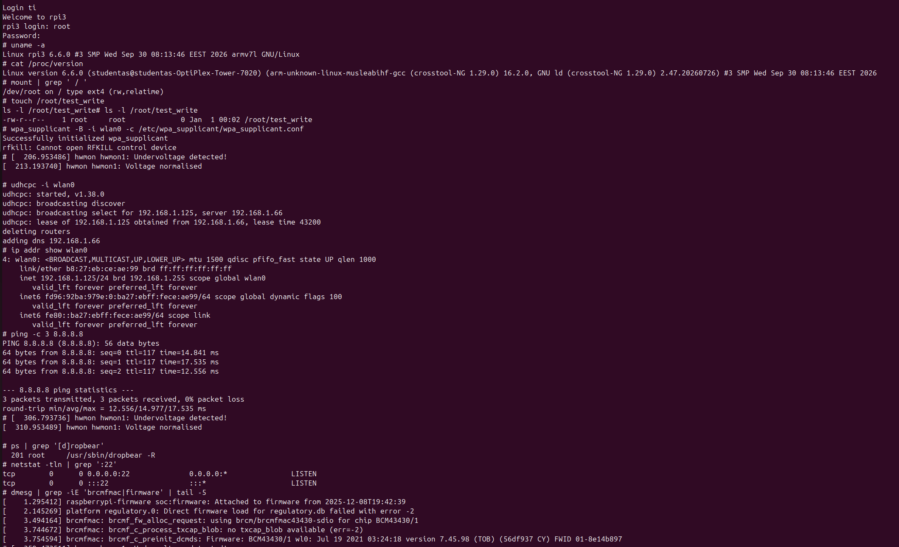
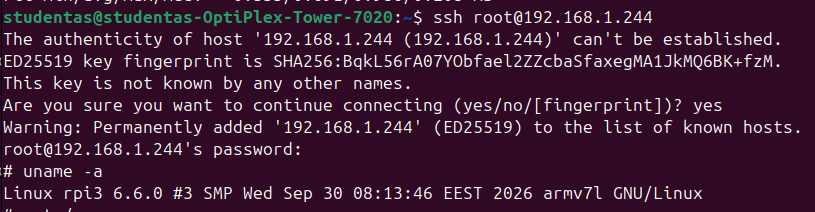

# Custom Linux for Raspberry Pi 3 Model B

A custom embedded Linux system built with **Buildroot** for the Raspberry Pi 3 Model B.

## Overview

This project demonstrates building and running a custom Linux system on physical ARM-based hardware. The generated SD card image was booted on a Raspberry Pi 3 Model B and tested for basic system operation, networking, and remote access.

## Technologies

- **Buildroot** — embedded Linux system generation
- **Linux kernel** — kernel for the target system
- **ARM** — target architecture
- **Raspberry Pi 3 Model B** — target hardware
- **BusyBox** — lightweight user-space utilities
- **wpa_supplicant** — wireless network configuration
- **udhcpc** — DHCP client
- **Dropbear SSH** — remote access

## Hardware Validation

The generated image was tested on a physical Raspberry Pi 3 Model B.

The validation included:

- Checking the running Linux kernel and system version.
- Inspecting the mounted root filesystem.
- Verifying write access to the root user's directory.
- Configuring Wi-Fi using `wpa_supplicant`.
- Obtaining an IP address using `udhcpc`.
- Testing network connectivity using `ping`.
- Checking the Dropbear SSH process and TCP port 22.
- Connecting remotely to the Raspberry Pi over SSH through a router.

### System and Network Validation



### Remote SSH Access



## Download

A prebuilt SD card image is available in [GitHub Releases](https://github.com/simelytii/custom_linux_for_rpi/releases/tag/buildroot-rpi3-2026-10-12).

Download the `sdcard.img.gz` asset from the release.

## Installation

1. Download `sdcard.img.gz` from the [GitHub Release](https://github.com/simelytii/custom_linux_for_rpi/releases/tag/buildroot-rpi3-2026-10-12).
2. Extract the image using:

   ```bash
   gzip -dk sdcard.img.gz
   ```

   This creates `sdcard.img` while keeping the compressed archive.

3. Write `sdcard.img` to an SD card using Raspberry Pi Imager, balenaEtcher, or another suitable imaging tool.
4. Insert the SD card into the Raspberry Pi 3 Model B and power on the board.

**Warning:** Writing an image overwrites the selected storage device. Make sure the correct SD card is selected before flashing.

## Build Documentation

The prebuilt image is available for download and testing. Detailed, reproducible build instructions and the complete Buildroot configuration have not yet been documented in this repository.
